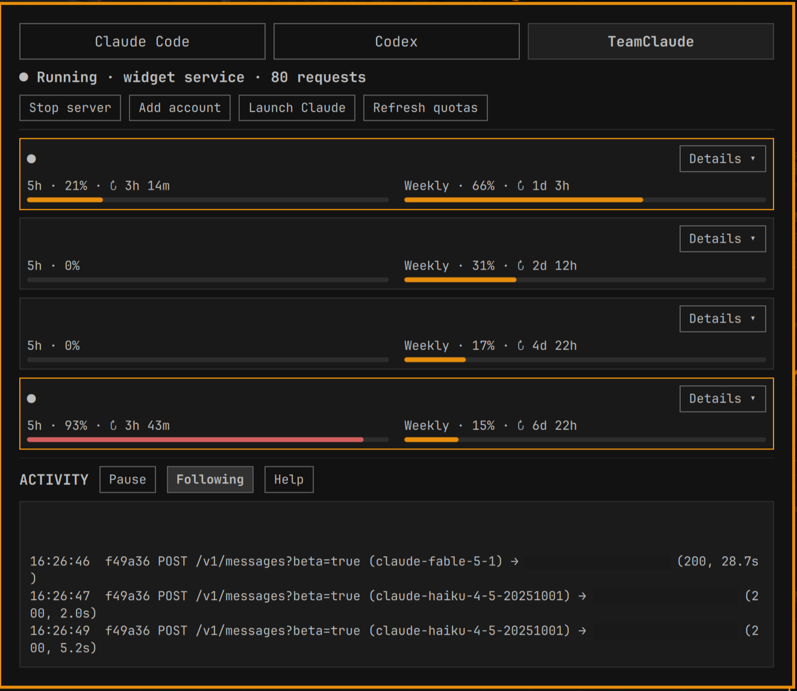

# Agents + TeamClaude

A user-owned clone of Omarchy's Agents bar widget, adding a TeamClaude tab.
The original Claude, Codex and Fireworks views remain available.



## Use

Open the AI/Agents icon in the bar and select **TeamClaude**.

The compact view keeps session/weekly meters side by side. Open an account’s
**Details** to see token counters, additional quota windows and management
controls. **Help** beside the activity console reveals logging instructions.

- **Start server / Stop server** manages a transient systemd user service,
  `omarchy-teamclaude.service`. It stays alive when the panel closes, but is
  not enabled automatically at login.
- **Add account** launches `teamclaude login` in a terminal and its normal
  browser sign-in flow. New accounts appear on the next refresh.
- **Launch Claude** runs `teamclaude run` in a terminal.
- **Refresh quotas** runs the read-only quota probe. Normal polling reads
  locally observed quotas; it does not send messages to Anthropic.
- Each account has usage meters and **Prefer**, **Enable/Disable**, and
  **Remove** controls. Removal asks for confirmation inside the panel.
- The activity console shows the latest 200 activity lines, with pause,
  follow and selectable text. Request completions include model, account,
  response code and duration when TeamClaude supplies them.

The widget reads the proxy every 1.5 seconds while its tab is open and every
15 seconds otherwise. It shows per-account token/request counters for the
current server run, and quota percentages/reset times reported by TeamClaude.
Quota meters are shown per account because each account has its own reset
period.

## Terminal-started servers

Plain `teamclaude login` and `teamclaude server` continue to work. The widget
detects a server at the configured local port. For its request console:

```sh
mkdir -p ~/.local/state/omarchy/teamclaude
teamclaude server --activity-log ~/.local/state/omarchy/teamclaude/activity.log
```

The Start button supplies the log flag automatically. Other activity-log paths
are discovered from a running local TeamClaude server's command line; set
`OMARCHY_TEAMCLAUDE_LOG` in the desktop environment to override discovery.
A server started elsewhere must be stopped in its own terminal or service
manager. The widget does not take over or terminate unrelated processes.
The console follows the same completed-request line format as TeamClaude's
terminal activity list. In-progress requests appear in its terminal TUI but
are not exposed by the server's control API or written to its activity file.
The widget calls this out when it detects a server without logging enabled.

## Account removal

If TeamClaude's management API is already enabled (`proxy.mcp: "full"`),
removal updates the running server and disk together. This plugin does not
enable that API. Otherwise, it uses the CLI to disable the account, confirms
that the running proxy applied the change, then removes the saved credentials.
The disabled runtime row remains until restart; the panel reports this.
In-flight requests are subject to TeamClaude's own behavior.

## Install / restore

Requires Omarchy's Quickshell Agents widget, Python 3, systemd user services,
and TeamClaude with `/teamclaude/status` and `/teamclaude/quota` endpoints.
Developed against the installed TeamClaude 1.1.x source.

```sh
git clone https://github.com/supercleanse/omarchy-teamclaude.git
cd omarchy-teamclaude
python3 install.py
```

The installer uses `omarchy plugin clone omarchy.agents`, installs into
`~/.config/omarchy/plugins/<username>.agents`, and saves a timestamped backup
under `~/.local/state/omarchy/teamclaude/`. Packaged Omarchy files are untouched.
The clone is a snapshot of the installed widget; future upstream changes need
to be incorporated into this source explicitly.

Restore the stock panel with:

```sh
omarchy plugin disable "$USER.agents"
omarchy plugin enable omarchy.agents
```

Stop the widget-owned proxy separately if needed:

```sh
systemctl --user stop omarchy-teamclaude.service
```

Troubleshoot startup with `journalctl --user -u omarchy-teamclaude.service`.
Configuration is read from `TEAMCLAUDE_CONFIG` or the standard XDG config path.
Credentials stay in the Python process and the local HTTP authentication
header; snapshots sent to QML contain only display fields. No request bodies
are collected. The activity file may include account names and request paths.
The console reads at most 64 KiB; logs larger than 4 MiB rotate on the next
widget-managed start, retaining one previous file.

## Validation

```sh
python3 -m unittest discover -v
TEAMCLAUDE_SOURCE=/path/to/node_modules/@karpeleslab/teamclaude/src \
  python3 -m unittest test_integration -v
```

The opt-in integration test starts a real TeamClaude HTTP server using only
synthetic credentials; it checks quota mapping, switching and live removal.
It does not send upstream requests.

Original Agents widget: Omarchy, MIT license. See `README.upstream.md`.
